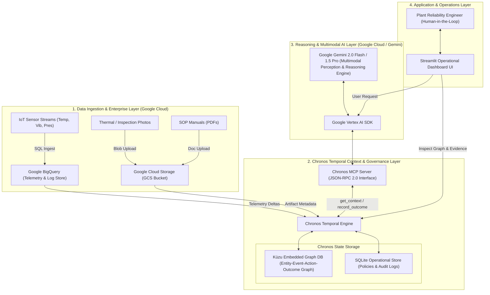

# CHRONOS — System Architecture Specification

**Document ID**: ARCH-03  
**Project**: CHRONOS  
**Track**: MAHE HackSprint Track PS42  
**Team**: GGs  
**Author**: Tanish Renuka Suragihalli  

---

## 1. High-Level System Architecture Diagram



---

## 2. Component Responsibility Breakdown

### 2.1 Google Cloud Storage (GCS)
- **What it does**: Provides enterprise object storage for unstructured multimodal assets (inspection photos, thermal diagnostics, PDF manuals).
- **Data Enters**: Raw binary images (`.png`/`.jpg`), SOP document files (`.pdf`).
- **Data Leaves**: Signed URIs, raw image bytes for Gemini multimodal processing.
- **Why it exists**: Scalable, enterprise-grade storage for large unstructured industrial assets.

### 2.2 Google BigQuery
- **What it does**: Stores high-throughput IoT time-series sensor telemetry and historical event logs.
- **Data Enters**: Streaming IoT sensor packets `[timestamp, asset_id, temp, vibration, pressure]`.
- **Data Leaves**: SQL time-window query results, statistical moving averages, anomaly deltas.
- **Why it exists**: Provides high-performance SQL analytical capabilities over millions of historical telemetry rows.

### 2.3 Chronos Temporal Context Engine & Kùzu Graph
- **What it does**: Reconstructs time-indexed asset states, maintains decision history, links past interventions to observed outcomes, and enforces SOP safety policies.
- **Data Enters**: Telemetry deltas from BigQuery, image metadata from GCS, past decisions, operator actions.
- **Data Leaves**: Structured `Context Package` JSON payloads.
- **Why it exists**: Gemini is stateless across sessions. Chronos maintains the persistent temporal graph and decision lineage required to prevent repetitive, failed interventions.

### 2.4 Chronos MCP Server
- **What it does**: Exposes standardized Model Context Protocol endpoints (`get_context`, `get_policy`, `record_decision`, `record_outcome`) over JSON-RPC 2.0.
- **Data Enters**: MCP tool invocation requests from Gemini / Vertex AI.
- **Data Leaves**: Formatted MCP response objects containing structured Context Packages or execution receipts.
- **Why it exists**: Standardizes how Gemini queries domain context without hardcoding custom API bindings into the LLM prompt pipeline.

### 2.5 Google Gemini 2.0 (via Vertex AI)
- **What it does**: Performs multimodal perception over images and text, synthesizes reasoning over the Chronos Context Package, and generates grounded recommendations.
- **Data Enters**: Visual inspection images + Chronos Context Package prompt.
- **Data Leaves**: Diagnosis, recommended operational action, confidence score, grounded evidence citations.
- **Why it exists**: Gemini provides state-of-the-art multimodal understanding and reasoning capable of correlating visual surface damage with temporal sensor anomalies.

### 2.6 Streamlit Operational Dashboard
- **What it does**: Renders live telemetry alerts, optical inspection photos, comparative reasoning displays (Baseline Gemini vs. Gemini + Chronos), and interactive audit trails.
- **Data Enters**: User anomaly triggers, Chronos graph queries, Gemini decision outputs.
- **Data Leaves**: Interactive human operator inputs (Approve action, override recommendation, trigger outcome writeback).
- **Why it exists**: Gives plant engineers intuitive visual oversight and human-in-the-loop control over critical industrial decisions.

---

## 3. Why Chronos Exists Between Data Layer and Gemini

A common question in AI architecture is:  
*"Why not feed raw BigQuery logs directly into Gemini's long context window?"*

Chronos exists between Google Cloud data storage and Gemini for five fundamental reasons:

```text
[ Raw Data Layer ] ──► [ Chronos Context Layer ] ──► [ Gemini Reasoning Engine ]
 (BigQuery / GCS)        (Temporal Graph & SOPs)        (Multimodal Model)
```

1. **Token Efficiency & Noise Filtering**: Raw telemetry contains thousands of identical, normal data points. Chronos extracts meaningful state deltas, trend shifts, and relevant historical precedent, packaging them into a concise, token-efficient payload ($< 1000\text{ tokens}$).
2. **Causal & Temporal Relationships**: SQL databases store rows; vector databases store similarity. Chronos stores **temporal causality** ($\text{Event}_A \rightarrow \text{Action}_B \rightarrow \text{Outcome}_C$), enabling Gemini to understand whether previous actions worked or failed.
3. **Deterministic Policy Enforcement**: Chronos evaluates SOP safety rules deterministically before Gemini responds, ensuring recommendations never violate plant safety bounds even if Gemini hallucinated.
4. **Outcome Memory Closed-Loop**: Vector DBs do not dynamically update state based on action feedback. Chronos records decision outcomes, allowing the system to continuously learn from past interventions.
5. **Auditable Provenance**: Chronos maintains explicit graph links between recommendations and underlying data sources, producing verifiable audit trails for safety compliance.
