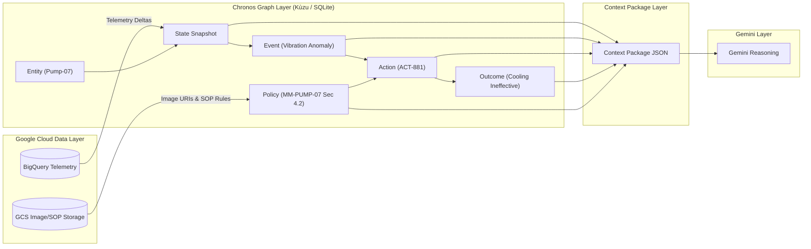

# CHRONOS — Data Architecture Specification

**Document ID**: DATA-04  
**Project**: CHRONOS  
**Track**: MAHE HackSprint Track PS42  
**Team**: GGs  
**Author**: Tanish Renuka Suragihalli  

---

## 1. Overview & Data Flow Pipeline

Data in Chronos moves through a four-stage pipeline:

$$\text{Google Cloud Data Layer} \longrightarrow \text{Chronos Temporal Graph} \longrightarrow \text{Context Package} \longrightarrow \text{Gemini Reasoning}$$



---

## 2. Google Cloud Enterprise Data Schemas

### 2.1 BigQuery Sensor Telemetry Table (`chronos_telemetry.sensor_readings`)

```sql
CREATE TABLE `chronos_telemetry.sensor_readings` (
    timestamp TIMESTAMP NOT NULL,
    asset_id STRING NOT NULL,
    temperature_c FLOAT64 NOT NULL,
    vibration_mms FLOAT64 NOT NULL,
    pressure_bar FLOAT64 NOT NULL,
    rpm INT64 NOT NULL,
    anomaly_flag BOOLEAN DEFAULT FALSE,
    ingestion_time TIMESTAMP DEFAULT CURRENT_TIMESTAMP()
)
PARTITION BY DATE(timestamp)
CLUSTER BY asset_id;
```

### 2.2 Google Cloud Storage Object Layout (`gs://chronos-industrial-artifacts/`)

```text
gs://chronos-industrial-artifacts/
├── images/
│   ├── PUMP-07/
│   │   ├── IMG_20260926_0914.png (Inspection photo: outer race bearing discoloration)
│   │   └── IMG_20260926_0914_thermal.png (Thermal capture: 78°C hotspot)
├── documents/
│   └── SOPs/
│       └── MM-PUMP-07.pdf (Pump Maintenance Manual & Governance Rules)
```

---

## 3. Chronos Temporal Graph Data Model (Kùzu Schemas)

### 3.1 Node Schemas

```cypher
// 1. Asset Entity Node
CREATE NODE TABLE Asset (
    id STRING,
    name STRING,
    location STRING,
    asset_type STRING,
    PRIMARY KEY (id)
);

// 2. Temporal State Snapshot Node
CREATE NODE TABLE StateSnapshot (
    id STRING,
    asset_id STRING,
    timestamp TIMESTAMP,
    temperature_c DOUBLE,
    vibration_mms DOUBLE,
    pressure_bar DOUBLE,
    rpm INT64,
    PRIMARY KEY (id)
);

// 3. Operational Action Node
CREATE NODE TABLE ActionNode (
    id STRING,
    action_type STRING,
    parameters STRING,
    timestamp TIMESTAMP,
    executed_by STRING,
    PRIMARY KEY (id)
);

// 4. Action Outcome Node
CREATE NODE TABLE OutcomeNode (
    id STRING,
    action_id STRING,
    temp_delta DOUBLE,
    vibration_delta DOUBLE,
    success BOOLEAN,
    observation STRING,
    PRIMARY KEY (id)
);

// 5. Policy / SOP Node
CREATE NODE TABLE PolicyNode (
    id STRING,
    document_id STRING,
    section STRING,
    rule_condition STRING,
    mandated_action STRING,
    PRIMARY KEY (id)
);
```

### 3.2 Relational Edge Schemas

```cypher
CREATE REL TABLE HAS_STATE(FROM Asset TO StateSnapshot);
CREATE REL TABLE TRIGGERED_ACTION(FROM StateSnapshot TO ActionNode);
CREATE REL TABLE PRODUCED_OUTCOME(FROM ActionNode TO OutcomeNode);
CREATE REL TABLE GOVERNED_BY(FROM ActionNode TO PolicyNode);
```

---

## 4. Context Package Schema (`get_context` Output Payload)

The Context Package is the structured, token-efficient JSON object generated by Chronos and passed directly into Gemini's system prompt:

```json
{
  "entity": {
    "asset_id": "PUMP-07",
    "asset_type": "Centrifugal High-Pressure Water Pump",
    "location": "Processing Bay 4"
  },
  "current_state": {
    "timestamp": "2026-09-26T09:40:00Z",
    "telemetry": {
      "temperature_c": 78.2,
      "vibration_mms": 3.8,
      "pressure_bar": 4.2
    },
    "deltas_last_30m": {
      "temperature_delta": "+13.2 C",
      "vibration_delta": "+1.8 mm/s"
    },
    "visual_inspection": {
      "image_id": "IMG_20260926_0914.png",
      "gcs_uri": "gs://chronos-industrial-artifacts/images/PUMP-07/IMG_20260926_0914.png",
      "thermal_hotspot_detected": true
    }
  },
  "recent_interventions": [
    {
      "action_id": "ACT-881",
      "timestamp": "2026-09-26T09:30:00Z",
      "action_type": "COOLANT_FLOW_BOOST",
      "parameters": {"target_flow_rate": "120%"},
      "observed_outcome": {
        "outcome_id": "OUT-881",
        "temperature_change": "-3.0 C (Slight improvement)",
        "vibration_change": "0.0 mm/s (REMAINED ELEVATED)",
        "success": false,
        "summary": "Cooling reduced temperature marginally but failed to damp vibration."
      }
    }
  ],
  "historical_precedents": [
    {
      "event_id": "EVT-2025-1104",
      "date": "2025-11-04",
      "signature": "Elevated temp + high vibration unaffected by cooling",
      "final_outcome": "Catastrophic bearing seizure within 12 hours of initial alert",
      "corrective_action_that_worked": "Controlled shutdown and bearing replacement"
    }
  ],
  "governing_policies": [
    {
      "policy_id": "POL-SOP-PUMP07-SEC4.2",
      "source_document": "MM-PUMP-07.pdf",
      "rule": "If vibration exceeds 3.5 mm/s and coolant adjustment produces no vibration reduction within 10 minutes, immediate physical bearing inspection is mandatory."
    }
  ],
  "provenance_signature": "CHRONOS-HASH-99F4A18B"
}
```

---

## 5. Decision & Outcome Feedback Writeback Payload (`record_outcome`)

When a human operator or Gemini records a decision and observes the resulting state, Chronos updates the graph via this schema:

```json
{
  "decision_id": "DEC-20260926-0940",
  "asset_id": "PUMP-07",
  "recommended_action": "BEARING_INSPECTION_AND_REPLACEMENT",
  "confidence_score": 0.96,
  "cited_evidence": [
    "IMG_20260926_0914.png",
    "ACT-881",
    "EVT-2025-1104",
    "POL-SOP-PUMP07-SEC4.2"
  ],
  "human_operator_approval": {
    "approved": true,
    "operator_id": "ENG_TURAGIHALLI",
    "timestamp": "2026-09-26T09:42:00Z"
  },
  "post_action_outcome": {
    "action_executed": "BEARING_REPLACEMENT",
    "execution_time": "2026-09-26T10:15:00Z",
    "resulting_telemetry": {
      "temperature_c": 64.8,
      "vibration_mms": 1.9,
      "pressure_bar": 4.2
    },
    "anomaly_resolved": true
  }
}
```
